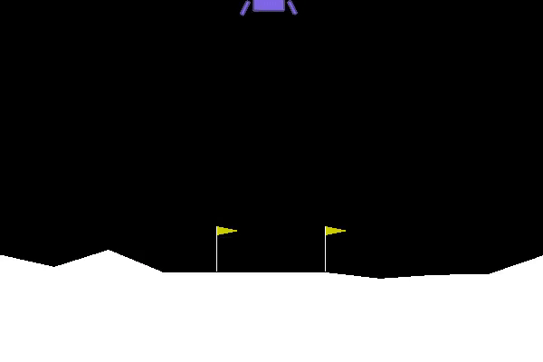
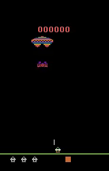
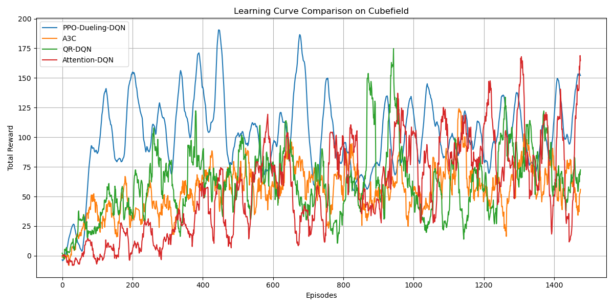

# Deep Reinforcement Learning on Game Environments

I implemented and compared a range of RL algorithms across four environments to see how
specific algorithmic changes, not just more training, affect learning speed and stability.
The environments are LunarLander, Assault, Super Mario Bros, and Cubefield (a custom one I built).

## LunarLander



Policy-gradient family: baseline REINFORCE, then REINFORCE with reward normalization, then
PPO on top. Reward normalization alone was a clear jump over the baseline; PPO's clipped
updates mostly bought stability.

## Assault



The DQN family, to isolate what each modification contributes: DQN, Double DQN (decouples
action selection from target evaluation to cut Q-value overestimation), Dueling DQN
(splits state value from action advantage), and the two combined.

## Cubefield



Cubefield is a custom environment I wrote: you steer through an oncoming field of cubes and
survive as long as possible, so the agent has to learn when and where to move as obstacles
approach. I used it as a harder, faster, image-based testbed and compared four more
specialized architectures:

- **PPO + Dueling DQN** - clipped PPO-style updates with a dueling head, for stability plus
  a clean split between how good a state is and how useful each action is.
- **Quantile Regression DQN** - predicts a distribution of returns instead of a single
  Q-value, to test whether modeling that distribution handles the randomness of the obstacle
  layouts better.
- **Attention DQN** - a multi-head attention block in the DQN, so the network can learn which
  part of the frame matters when deciding how to dodge.
- **A3C** - actor-critic, where the critic's advantage estimate drives the policy updates.

The four differed noticeably in learning speed, stability, and peak reward.

## Super Mario Bros

Used to experiment with A2C actor-critic. Mario is harder because the consequences of an
action are delayed and the agent has to learn both movement and exploration over long
sequences.

## What I took from it

The point wasn't to max out any single game score. It was to build these algorithms myself
rather than call them from a library, and watch how reward normalization, Double Q-learning,
dueling heads, PPO clipping, quantile regression, and attention each change the agent's
behaviour. That hands-on comparison is the part that stuck.

## Running it

```bash
pip install -r requirements.txt
```

Policy gradient:

```bash
python main.py --train_pg --pg_type=pg_nor --folder_name=<your_folder>
python main.py --test_pg --model_path=./model/best/pg.cpt
```

DQN (swap `--dqn_type` for the variant: DQN, DoubleDQN, DuelingDQN, DDDQN):

```bash
python main.py --train_dqn --dqn_type=DoubleDQN --folder_name=<your_folder>
python main.py --test_dqn --dqn_type=DDDQN --model_path=./model/best/dqn.cpt
```

Cubefield is self-contained:

```bash
python Cubefield.py
```

## Layout

```text
main.py          entry point for the LunarLander / Assault experiments
Cubefield.py     the custom environment and its agents
agent_dir/       policy-gradient, PPO, DQN, and A2C agents
a2c/             actor-critic and the vectorized-env plumbing
plot.py          learning-curve plots
```

Built with Python, PyTorch, OpenAI Gym, the Atari Learning Environment, gym-super-mario-bros,
NumPy, Matplotlib, and PyGame.
